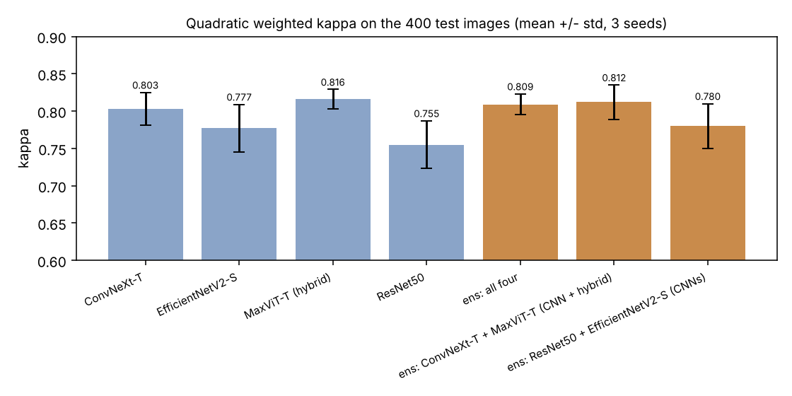
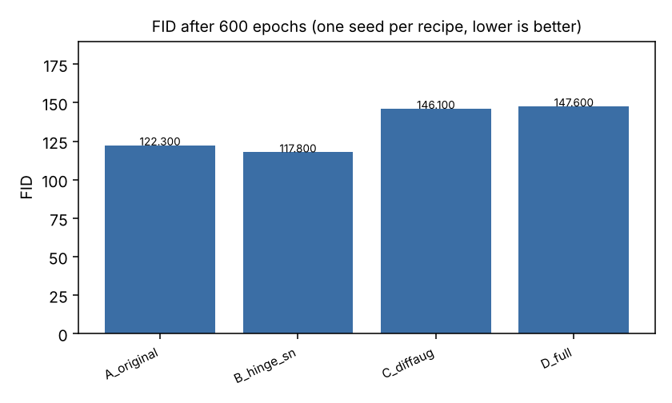
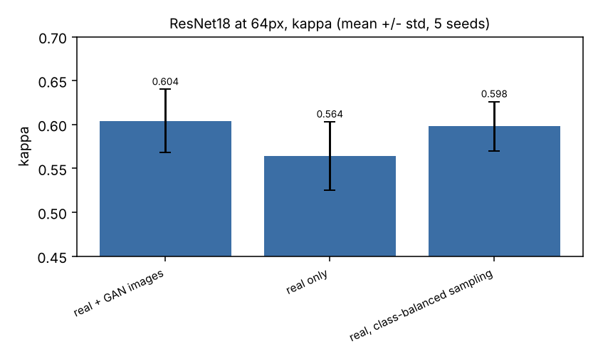

# Retinopathy Lab

**Grade the retina. Test every idea.**

Retinopathy Lab grades diabetic retinopathy from fundus photos into five levels, and studies whether conditional GANs can make useful synthetic retina images. It is a set of six repeatable experiments on the public RetinaMNIST dataset, every result produced by a run you can repeat, with 3 to 5 seeds each and mean and standard deviation reported.

Built for research and learning. It is not a medical device.

## How it helps

Diabetic retinopathy is a leading cause of preventable vision loss, and grading it is a screening bottleneck. This project answers practical questions for anyone building a grader on a small, imbalanced dataset: which backbone to start from, whether ensembling helps, whether to treat the grades as ordered, whether contrast preprocessing is worth it, and whether synthetic images add anything beyond resampling.

## Experiments

| experiment | question |
|---|---|
| E1 backbones | ResNet50, EfficientNetV2-S, ConvNeXt-T and MaxViT-T (a convolution and attention hybrid). Which one grades best? |
| E2 ensembles | Does averaging the models help? CNN only, CNN plus hybrid, all four. |
| E3 head | Plain 5-class logits or a single ordinal regression output? |
| E4 preprocessing | Does Ben Graham contrast normalisation help? |
| E5 GAN recipes | Four recipes for a conditional GAN, compared by FID. |
| E6 synthetic data | Does adding GAN images to the training set help a classifier, compared with just resampling? |

## Data

RetinaMNIST from MedMNIST v2, the 224 by 224 version, with the split that ships with the dataset. Five grades: no DR, mild, moderate, severe, proliferative.

| split | no DR | mild | moderate | severe | proliferative | total |
|---|---|---|---|---|---|---|
| train | 486 | 128 | 206 | 194 | 66 | 1080 |
| val | 54 | 12 | 28 | 20 | 6 | 120 |
| test | 174 | 46 | 92 | 68 | 20 | 400 |

## How it works

```
RetinaMNIST --> backbone (ImageNet weights) --> head (class logits or ordinal) --> grade 0-4
                    |                                                                  |
              25 epochs, AdamW, one-cycle LR,                               metrics: quadratic weighted kappa,
              mixed precision, augmentation                                 accuracy, macro F1, referable-DR AUC
```

All backbones start from ImageNet weights. Training uses AdamW, a one-cycle learning rate, mixed precision, 25 epochs, flips, small rotations and light colour jitter. The epoch is picked on the validation set, never on test. For the ordinal head the cut points between grades are also fitted on validation. Ensembles average class probabilities. The headline metric is quadratic weighted kappa, because grades are ordered and a 0 vs 4 mistake should cost more than 0 vs 1.

## Results

All on the 400 test images, mean and standard deviation over 3 seeds. Full tables are in `results/RESULTS.md`.

### Models and ensembles



| model | kappa | accuracy | macro F1 | referable AUC |
|---|---|---|---|---|
| ResNet50 | 0.755 +/- 0.032 | 0.615 | 0.479 | 0.925 |
| EfficientNetV2-S | 0.777 +/- 0.032 | 0.653 | 0.520 | 0.949 |
| ConvNeXt-T | 0.803 +/- 0.022 | 0.676 | 0.569 | 0.957 |
| **MaxViT-T (hybrid)** | **0.816 +/- 0.013** | 0.681 | 0.562 | 0.968 |
| ensemble, all four | 0.809 +/- 0.014 | 0.686 | 0.566 | 0.967 |
| ensemble, ConvNeXt-T + MaxViT-T | 0.812 +/- 0.023 | 0.691 | 0.584 | 0.970 |
| ensemble, ResNet50 + EfficientNetV2-S | 0.780 +/- 0.030 | 0.662 | 0.534 | 0.952 |

The two modern models, MaxViT-T and ConvNeXt-T, lead ResNet50 clearly. MaxViT-T has the best kappa and referable AUC, and the ConvNeXt-T plus MaxViT-T pair has the best accuracy and macro F1. Training takes about 364 seconds a run for MaxViT-T against 201 for ConvNeXt-T.

### Head and preprocessing (MaxViT-T)

| variant | kappa | accuracy | macro F1 | referable AUC |
|---|---|---|---|---|
| class logits (baseline) | 0.816 +/- 0.013 | 0.681 | 0.562 | 0.968 |
| ordinal regression | 0.834 +/- 0.019 | 0.652 | 0.516 | 0.973 |
| Ben Graham preprocessing | 0.827 +/- 0.020 | 0.702 | 0.564 | 0.971 |

The ordinal head gives the best kappa and Ben Graham preprocessing gives the best accuracy.

### GAN recipes

A conditional GAN at 64 by 64 pixels, 600 epochs. Recipe A uses BCE loss, dropout 0.3, no augmentation and a 1e-4 learning rate. B uses hinge loss and spectral norm. C adds DiffAugment. D adds an EMA copy of the generator.



| recipe | FID | nearest training image, generated | nearest training image, unseen real |
|---|---|---|---|
| A baseline | 122.3 | 7.53 | 6.73 |
| B hinge + spectral norm | 117.8 | 8.12 | 6.73 |
| C + DiffAugment | 146.1 | 10.77 | 6.73 |
| D + EMA | 147.6 | 10.77 | 6.73 |

FID uses torchvision's InceptionV3 features, so it ranks recipes against each other. Generated images sit further from their closest training image than held-out real images do, so the generator is not copying its training set.

### Does GAN data help a classifier

ResNet18 at 64 by 64, 5 seeds. GAN images from the lowest-FID recipe top up the small classes until they match the biggest one.



| training data | kappa | accuracy | macro F1 | recall for grades 0 to 4 |
|---|---|---|---|---|
| real only | 0.564 +/- 0.039 | 0.531 | 0.391 | 0.73 / 0.18 / 0.50 / 0.42 / 0.14 |
| real + GAN images | 0.604 +/- 0.036 | 0.538 | 0.394 | 0.73 / 0.19 / 0.57 / 0.35 / 0.18 |
| real, class-balanced sampling | 0.598 +/- 0.028 | 0.496 | 0.401 | 0.67 / 0.46 / 0.37 / 0.31 / 0.30 |

GAN images raise kappa by 0.04, and class-balanced sampling reaches nearly the same kappa without any GAN. Class-balanced sampling lifts recall for the rare grades most: mild from 0.18 to 0.46 and proliferative from 0.14 to 0.30.

## Tech stack

Python, PyTorch and torchvision, scikit-learn, SciPy, OpenCV, Matplotlib, MedMNIST, pytest. The full run takes about 90 minutes on two T4 GPUs.

## Run it

```
pip install -r requirements.txt
python -m retinolab.run_all --stage all --out runs
```

Stages can be run one at a time with `--stage cls|ens|abl|gan|synth|explain|report`, and finished runs are skipped when you start again. If you run stages in separate processes, download the data once first so two processes don't write the file at the same time.

```
pip install -r requirements-dev.txt
pytest
```

The tests run on CPU and cover the metrics, data handling, models, resuming, ensembles, the GAN and the FID. `tools/plot_from_results.py` redraws the charts from `results/RESULTS.md`.

## Layout

```
retinolab/   the package (data, models, training, GAN, FID, reports)
tests/       cpu tests
results/     RESULTS.md with all tables
docs/        charts used in this readme
tools/       small helper scripts
```

## License

MIT
